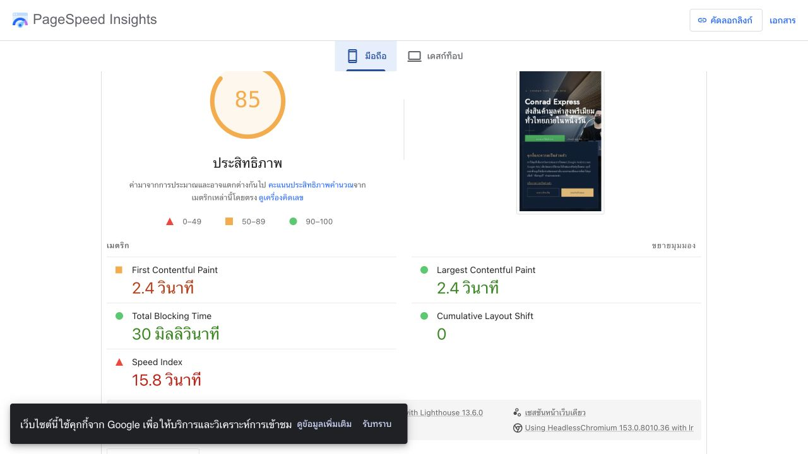

# Conrad Express — รายงานสาเหตุที่เว็บไซต์หน่วง

วันที่ตรวจ: 6 พฤศจิกายน 2026 · เว็บจริง: https://conradexpress.com/

ตรวจโค้ด เทียบไฟล์กับ production และวัดด้วย PageSpeed Insights ทั้งมือถือและเดสก์ท็อป รอบนี้เพิ่มเฉพาะรายงานกับหลักฐาน ยังไม่ได้แก้โค้ดหรือ deploy

## ข้อสรุป

ปัญหาที่มีหลักฐานชัดที่สุดคือ **ภาพใหญ่เกินพื้นที่แสดงและการจัดลำดับโหลดภาพ** ตามด้วย **งานคำนวณ layout ของ CardSwiper** และ **แอนิเมชันที่ตั้งเวลาให้เนื้อหาปรากฏช้า** บริเวณรีวิวมีทั้งรูปใหญ่และเงาที่เคลื่อนไหว จึงควรตรวจเป็นลำดับแรกหากสะดุดขณะเปลี่ยนรูป

ปุ่มลอยที่หลบ footer มีการอัปเดตตำแหน่งถี่เมื่อ footer เข้าจอ แต่ยังไม่มีการวัด FPS หรือทดสอบเปรียบเทียบเปิด/ปิดที่พิสูจน์ว่าเป็นต้นเหตุ จึงแยกเป็นข้อสงสัย ไม่สรุปว่าเป็นสาเหตุของอาการทั้งหน้า

## ผลวัดเว็บจริง

[PageSpeed Mobile](https://pagespeed.web.dev/analysis/https-conradexpress-com/d24xlnoee2?form_factor=mobile) · [PageSpeed Desktop](https://pagespeed.web.dev/analysis/https-conradexpress-com/d24xlnoee2?form_factor=desktop)

รายงานแสดงเวลาบันทึก **6 พ.ย. 2026 เวลา 10:08 GMT+7** ใช้ Lighthouse 13.6.0 / HeadlessChromium 153.0.8010.36 มือถือจำลอง Moto G Power บน slow 4G ผลนี้เป็นการทดสอบโหลดหน้าในสภาพจำลอง ไม่ใช่ค่าเฉลี่ยผู้ใช้จริง และ PageSpeed ยังไม่มีข้อมูลภาคสนาม (CrUX) สำหรับหน้านี้

| เมตริก | Mobile | Desktop |
|---|---:|---:|
| Performance score | 85/100 | 91/100 |
| First Contentful Paint | 2.4 วินาที | 0.2 วินาที |
| Largest Contentful Paint | 2.4 วินาที | 1.5 วินาที |
| Speed Index | **15.8 วินาที** | 2.0 วินาที |
| Total Blocking Time — ค่าที่ UI แสดง | 30 ms | 60 ms |
| Cumulative Layout Shift | 0 | 0 |
| Network payload ที่ Lighthouse พบ | 19,361 KiB | 22,323 KiB |
| ขนาดภาพที่ประเมินว่าลดได้ | **14,917 KiB** | **21,119 KiB** |
| Forced reflow ที่โยงถึง CardSwiper | **66 ms รวม** | **142 ms รวม** |

Speed Index วัดความคืบหน้าในการแสดงภาพ ไม่ใช่เวลาตอบกลับของเซิร์ฟเวอร์หรือ FPS ส่วน TBT ที่ต่ำบอกว่างาน JavaScript ในช่วงโหลดที่ Lighthouse นับไม่ได้ปิดกั้นหน้าจอหนักมาก แต่ใช้ยืนยันความลื่นขณะเลื่อนทั้งหน้าไม่ได้

ตรวจผ่าน HTTP แล้ว `index.html` และ `dist/conrad-express.bundle.js` บน production ตรงกับไฟล์ในเครื่องทุกไบต์ Bundle SHA-256 คือ `665b27833a0395bed0d4161ea7e2134fec761a7ec1e8b21f0c54f2a95481654d` จึงจับคู่ตำแหน่งใน bundle กับ source รุ่นเดียวกันได้

## 1. ภาพใหญ่เกินไป — ยืนยันจากไฟล์, DOM และ Lighthouse

| ชุดรูปที่ใช้จริง | ขนาดไฟล์รวม | ขนาดภาพ / การใช้งาน |
|---|---:|---|
| review-9/10/11.jpg | **11.78 MB** | แต่ละรูป 4284×5712 พิกเซล แต่แสดง 400×520 CSS px |
| รีวิวที่ใช้ทั้ง 6 รูป | **12.17 MB** | หมายเลข 9, 10, 11, 2, 4, 5 |
| Services ทั้ง 10 รูป | **9.00 MB** | ต้นฉบับ 2000×2000 พิกเซล; แสดงบนเดสก์ท็อปที่ตรวจประมาณ 220×189 CSS px |
| Services 5 รูปแรก | **5.97 MB** | กำหนด `loading="eager"` และ `fetchPriority="high"` |
| Hero | 0.574 MB | มี preload / high priority สำหรับภาพแรก |

MB ในตารางเป็นหน่วยฐานสิบจากจำนวนไบต์จริง ภาพที่มีอยู่ใน DOM ทั้ง Hero, โลโก้, Services, Reviews และ Process ขั้นแรก รวมประมาณ 22.48 MB หากโหลดครบ ไม่ใช่ขนาดที่ทุกอุปกรณ์ต้องโหลดทันที

หลักฐานใน source:

- [Services.jsx](../src/components/sections/Services.jsx) บรรทัด 448–450: ภาพบริการ 5 รูปแรกใช้ eager/high แม้อยู่ถัดจาก Hero เมื่อรวม Hero มีภาพที่ถูกเร่งโหลดประมาณ **6.55 MB** จึงมีโอกาสแย่งแบนด์วิดท์ของภาพแรก
- [Testimonials.jsx](../src/components/sections/Testimonials.jsx) บรรทัด 6, 73 และ 175: ใช้รูปรีวิวขนาดใหญ่ แสดงความกว้างไม่เกิน 400 px และสูง 520 px แต่ยังเรียก JPG ต้นฉบับ ไม่มี `srcSet` / `sizes` ภาพบริการก็ยังไม่มีชุดภาพตามขนาดหน้าจอ
- HTTP HEAD ของ review-9 ยืนยัน `Content-Length: 4168399`; ภาพ Gold มี 1,766,843 ไบต์ ตรงกับไฟล์ในเครื่อง

**ผลต่ออาการ:** โหลดครั้งแรกช้าโดยเฉพาะมือถือหรือเครือข่ายจำกัด และต้องถอดรหัส/ย่อภาพใหญ่เมื่อใช้งานรีวิว ยังไม่ได้วัดเวลาถอดรหัสภาพหรือหน่วยความจำ GPU โดยตรง

**แนวแก้แรก:** สร้างภาพรีวิวและบริการหลายขนาดตามพื้นที่แสดงกับ DPR ใช้ WebP/AVIF พร้อม `srcset` / `sizes` ให้ภาพนอกจอโหลดแบบ lazy ด้วย priority ปกติ Lighthouse ประเมินโอกาสลดภาพบนมือถือประมาณ 14.6 MiB ซึ่งยังไม่ใช่ผลหลังแก้จริง

## 2. CardSwiper บังคับคำนวณ layout — วัดพบจริง

Lighthouse ชี้ไปที่ `bundle.js:2:9857` ตรงกับ [shared.jsx](../src/components/shared.jsx) บรรทัด 60 ใน `CardSwiper.measure()` ซึ่งอ่าน `scrollWidth - clientWidth` ภายใน `useLayoutEffect`

Effect ทำงานหลัง React ใส่ DOM และก่อนวาดหน้า จึงอาจบังคับให้เบราว์เซอร์คำนวณ layout ที่ค้างอยู่ การวัดยังทำกับทั้ง Services และ Packages แม้อยู่บนเดสก์ท็อปที่ไม่ได้ใช้ carousel รอบนี้พบ forced reflow รวม **66 ms บนมือถือ และ 142 ms บนเดสก์ท็อป** ที่ตำแหน่งดังกล่าว

การอ่านขนาดลูกแต่ละใบไม่ได้ทำให้เกิด layout flush ทุกครั้ง เพราะอ่านเป็นกลุ่มโดยไม่มีการเขียน DOM คั่น และโค้ดนี้ไม่ได้ทำให้ App render ทั้งหน้าทุกจังหวะ scroll

**แนวแก้:** วัดเฉพาะเมื่อใช้โหมด carousel และ section ใกล้จอ ลดการวัดซ้ำเมื่อ parent render และย้ายการวัดที่ไม่จำเป็นออกจากช่วงก่อนวาดหน้าครั้งแรก

## 3. แอนิเมชันตั้งเวลาให้ปรากฏช้า — ยืนยันจากโค้ด

- [Hero.jsx](../src/components/Hero.jsx) บรรทัด 38–43: เล่น 700 ms และหน่วงสูงสุด 800 ms ส่วนสุดท้ายจึงจบที่ **1.5 วินาที** ปุ่มจองจบประมาณ 1.22 วินาที
- [index.html](../index.html) บรรทัด 95–122: reveal ใช้ 800–900 ms
- [index.html](../index.html) บรรทัด 132–139: การ์ดใบที่ 6 รอ 600 ms แล้วเล่น 700 ms รวม **1.3 วินาที**

ผู้ใช้จึงยังรอให้เนื้อหาค่อย ๆ ปรากฏแม้โหลดเสร็จแล้ว เวลาที่ตั้งไว้เหล่านี้อธิบายความรู้สึกช้า แต่ไม่ได้ยืนยันว่า FPS ตก หรืออธิบาย Speed Index 15.8 วินาทีทั้งหมด

**แนวแก้:** ลดการปรากฏเป็นประมาณ 180–300 ms ลดเวลารอระหว่างการ์ด และรองรับ `prefers-reduced-motion` ให้ครอบคลุม Hero, reveal และ autoplay

## 4. งานวาดและ layout ระหว่างแอนิเมชัน

- **วัดพบใน Lighthouse:** เส้นตกแต่ง `lineGrow` ใน Hero เคลื่อนไหวด้วย `width` เป็น non-composited animation 1 จุด ควรใช้ความกว้างคงที่แล้วเคลื่อนไหวด้วย `scaleX`
- **ต้องวัดเพิ่มในช่วงรีวิวเปลี่ยน:** [Testimonials.jsx](../src/components/sections/Testimonials.jsx) บรรทัด 165–168 เปลี่ยน `box-shadow` นาน 500 ms เงาของการ์ด active มีหลายชั้นและ blur 32/60 px ทุก 6 วินาทีเมื่อ section อยู่ในจอ การ์ดเก่าและใหม่ 2 ใบเปลี่ยนเงาพร้อม transform/opacity; DOM จริงยืนยัน `transition: box-shadow 0.5s`
- **ต้องวัดเพิ่มเมื่อ hover/focus บริการ:** [Services.jsx](../src/components/sections/Services.jsx) บรรทัด 211 และ 226 เปลี่ยน margin/max-height นาน 260–320 ms พร้อม opacity/เงา ทำให้มีงาน layout/paint ระหว่างการใช้งานการ์ด แม้มี `contain` ช่วยจำกัดพื้นที่

**แนวแก้:** ให้เงาคงที่และเคลื่อนไหวเฉพาะ transform/opacity ใช้พื้นที่ข้อความคงที่แทนการขยับความสูงหรือ margin ควรวัดการเลื่อนและการใช้งานหลังลดขนาดภาพก่อน ไม่เพิ่ม `will-change` ให้ทุก element โดยไม่มีหลักฐาน

## 5. ปุ่มลอยหลบ footer — ข้อสงสัยเฉพาะช่วงท้ายหน้า

[FloatingLine.jsx](../src/components/FloatingLine.jsx) บรรทัด 24–44 อ่านตำแหน่ง footer ผ่าน scroll/rAF แล้วเรียก `setLift` ก่อนเปลี่ยน CSS `bottom` เพิ่มใน commit `e0d0b7f` วันที่ 5 พ.ย. เวลา 17:50 +0700

จำลอง callback ของ component จริง 120 จังหวะ โดยไม่แก้ source:

| สถานการณ์จำลอง | อ่าน geometry | เรียก setter | ค่า state เปลี่ยน |
|---|---:|---:|---:|
| Footer ยังไม่ถึงจอ | 120 | 120 | **0** |
| Footer กำลังเข้าจอ | 120 | 120 | **119** |

เมื่อค่าเดิม React ข้ามการอัปเดตได้ จึงไม่ควรกล่าวว่าปุ่มลอย render ทุกจังหวะตลอดทั้งหน้า แต่ช่วง footer เข้าจอมีการอัปเดต React และ `bottom` แทบทุกจังหวะ ตำแหน่ง footer `bundle:2:120662` ได้เวลา 0 ms ใน Lighthouse เดสก์ท็อปรอบนี้ จึงยังไม่มีหลักฐานที่ผูกอาการกระตุกกับโค้ดนี้

**แนวแก้หากวัดยืนยัน:** ใช้ IntersectionObserver เปิดการวัดเฉพาะใกล้ footer แล้วประเมิน transform/ref แทน state + bottom ทุกพิกเซล

## 6. Render-blocking และ third-party — ปัจจัยรอง

- Lighthouse มือถือระบุ `analytics.js` แบบ synchronous และ `fonts.css` เป็น render-blocking โดยประเมินโอกาสประหยัด 1,670 ms ตัวเลขนี้ไม่ใช่เวลา CPU หรือเวลาที่รับประกันว่าจะลดได้
- GTM 158 KiB ใช้ main thread 127 ms บนมือถือ และมี long task 84 ms ขณะที่ React มี task หนึ่ง 70 ms; TBT รวมที่ UI รายงานอยู่ที่ 30 ms
- ควรแยกส่วนตั้งค่า consent ก่อนโหลด tags ให้เล็ก แล้วประเมิน defer งานอื่น โดยรักษา Consent Mode defaults และ conversion tracking
- App bundle มีขนาดจริง 132,953 ไบต์ และส่งหลังบีบอัด 30,719 ไบต์ การเรียก HTTP ตัวอย่างหนึ่งครั้งได้ HTML TTFB ประมาณ 0.227 วินาที และ bundle TTFB ประมาณ 0.139 วินาที ใช้แทนผลของผู้ใช้ทุกคนไม่ได้
- รูปส่ง `cache-control: public, max-age=0, must-revalidate` มีทั้ง CDN HIT และ MISS ยังไม่มีหลักฐานว่า hosting เป็นคอขวดหลัก หากเพิ่ม cache ระยะยาวควรเปลี่ยนชื่อไฟล์ตามรุ่นก่อน

## ลำดับงานที่แนะนำ

1. ลดขนาดรูปและแก้ priority ของภาพนอกจอ
2. ลดงานวัด layout ใน CardSwiper
3. ลดเวลา reveal และเลิกเคลื่อนไหว width/height/margin/เงาหนัก
4. บันทึก FPS ช่วงท้ายหน้าและทดสอบเปิด/ปิดการหลบ footer ก่อนแก้จุดนี้
5. ปรับการโหลด analytics/CSS โดยรักษา consent และ conversion
6. วัดซ้ำทั้ง cache ว่างและ cache อุ่นบนมือถือ ทดสอบเลื่อนผ่าน Services/Reviews/Contact และบันทึก frame time, FPS, long animation frames กับหน่วยความจำ ก่อนสรุปผลก่อน/หลัง ส่วน INP ต้องเก็บจากการใช้งานจริง

## หลักฐานและข้อจำกัด

- [Measurements JSON](performance-evidence/2026-11-06/measurements.json)
- [Mobile audits](performance-evidence/2026-11-06/mobile-audits.json), [Mobile snapshot](performance-evidence/2026-11-06/pagespeed-mobile.txt)
- [Desktop reflow](performance-evidence/2026-11-06/desktop-reflow.json), [Desktop snapshot](performance-evidence/2026-11-06/pagespeed-desktop.txt)
- [Live DOM และ priority](performance-evidence/2026-11-06/live-dom.json), [ขนาดรีวิวและ transition บนเว็บจริง](performance-evidence/2026-11-06/live-review-images.json)
- ตรวจ production แบบอ่านอย่างเดียว ไม่มีการส่งฟอร์ม อีเมล หรือเขียน Google Sheets
- ยังไม่ได้บันทึก FPS ระหว่างเลื่อน วัดหน่วยความจำเบราว์เซอร์จริง หรือทดสอบเปรียบเทียบหลังแก้โค้ด

